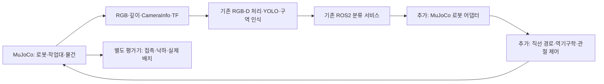

# Humble/noVNC에서 AI WORKER 분류 테스트 연결 설계

2026-11-18 기준. 구현 구조와 검증 범위를 기록한다. 사용자 실행 절차는 [시뮬레이션 가이드](../SIMULATION.md)를 따른다.

## 확인한 범위

- 로컬 `ros-humble-novnc-docker-ros-humble-novnc:latest`에서 Ubuntu 22.04, ROS2 Humble, Python 3.10 확인.
- 같은 이미지의 임시 컨테이너에 MuJoCo 3.5.0을 설치해 공식 SG2·BG2 모델 로드, 모델별 물리 연산 500단계와 RGB·미터 단위 깊이 영상 생성 성공.
- SG2 왼팔 7개 관절로 위치·자세를 함께 맞추는 국소 역기구학 시험 3건 성공. 위치 오차 0.061~0.997mm. 충돌 경로·전체 작업 범위·실제 집기 성공을 검증한 시험은 아니다.
- SG2 모델에는 RH-P12-RN 그리퍼와 좌우 그리퍼 구동기가 있다. 사용자가 보유한 로봇의 정확한 본체 모델은 아직 확정하지 않았다.
- 구현 후 전체 Humble 빌드와 noVNC 영상 표시를 확인했다. 이미지 내장 YOLO와 기존 ROS2 서비스를 통해 두 종류 물건 4개 분류가 통과했다. 각 물건의 실제 양쪽 접촉·상승·최종 구역과 테이블 높이를 검사했다.
- 실행 중 취소·지연 명령 차단, 단위 검사 91개, 기존 실기 경로 13개·교시 경로 7개 회귀 시나리오도 통과했다. 실기 경로 회귀는 제어기를 소프트웨어로 대체한 시험이다.

모델 출처: https://github.com/ROBOTIS-GIT/robotis_mujoco_menagerie

검증 모델 커밋: `d8344c0dbe7a00208d0301111523dde65efc174a`.
국소 검증 결과는 로컬 `.runtime/humble-model-results/`에 있다. 해당 폴더는 Git 배포 대상이 아니다.

## 실행 구조

기존 `/worker/prepare_auto_sort`, `/worker/start_task`, 상태 조회·취소 서비스와 자동 색 구역 배정은 재사용한다. 사용자 메뉴는 물건 종류나 테이프 색을 고정하지 않는다.

초기 범위는 한쪽 팔로 수행하는 두 종류 물건 분류다. 오른팔·이동 베이스는 정지시킨다. 양팔 협업은 후속 범위다.

## 1. 가상 장면

- 공식 SG2 모델에 별도 장면 파일을 덧붙인다. 모델 원본과 출처·라이선스는 보존한다.
- 베이스는 고정하고 작업대, 두 종류 물건 여러 개, 서로 다른 색의 닫힌 사각형 테이프 구역 두 개를 배치한다.
- 테이프는 시각 요소이며 물건을 막는 벽으로 만들지 않는다. 시각 표면 겹침으로 발생하는 깜빡임을 피한다.
- 초기 장면은 고정 난수 시드로 재현한다. 이후 색·조명·물건 위치를 바꾼다. 인식 코드에 정답 색을 전달하지 않는다.
- 첫 가상 카메라는 작업대 전체와 들어 올린 물건이 보이는 고정 시점이다. 손목 카메라는 첫 연결에 필수로 넣지 않는다.
- 카메라-작업대 거리는 현재 코드의 유효 깊이 0.1~2m에 맞춘다. 앞서 만든 로봇 전체 미리보기 시점은 분류용 카메라로 사용하지 않는다.
- 작업 영역, TCP 변환, 초기 자세와 집기 높이는 검증된 장면 프로필에서 읽는다. 시뮬레이션 시작 때 사용자가 실측·조그 교시를 반복할 필요가 없다.
- 프로필 범위는 임의로 넓히지 않는다. 전체 접근·집기·운반·배치 경로의 도달 가능성과 충돌을 검사한 뒤 확정한다.

## 2. 가상 카메라와 TF

MuJoCo 브리지가 다음 데이터를 같은 시뮬레이션 시각으로 발행한다.

| 데이터 | 제안 인터페이스 |
|---|---|
| RGB | `/sim/camera/color/image_raw`, `sensor_msgs/Image`, `rgb8` 또는 `bgr8` |
| 정렬된 깊이 | `/sim/camera/aligned_depth_to_color/image_raw`, `32FC1`, 미터 |
| 내부 파라미터 | `/sim/camera/color/camera_info`, `CameraInfo` |
| 관절 상태 | `/sim/joint_states`, `JointState` |
| 로봇·카메라·TCP 좌표 | `/tf`, `/tf_static`의 `sim_` 접두 프레임 |
| 시뮬레이션 시간 | `/clock`, `rosgraph_msgs/Clock` |

- RGB와 깊이는 같은 카메라·해상도·촬영 시각을 사용한다. 렌더링에서 RGB→BGR 변환을 명시한다.
- 내부 파라미터는 실제 렌더링의 시야각과 투영 행렬에서 계산한다. 왜곡은 0, 정류 행렬은 단위 행렬이다.
- MuJoCo 카메라의 위/뒤 방향과 ROS optical frame의 아래/앞 방향을 변환한다. MuJoCo `WXYZ`와 ROS `XYZW` 쿼터니언 순서도 구분한다.
- 깊이는 투영축의 거리인지 검증하고, 알려진 3D 점을 영상에 투영·역투영해 좌표 오차를 검사한다.
- 초기 연결에서는 MuJoCo의 실제 body/site 변환으로 TF를 발행한다. TCP는 움직이지 않는 고정 site로 정의하고, 같은 프레임의 TF를 다른 노드가 중복 발행하지 않는다.
- URDF를 사용하는 도구 형상 계산은 MuJoCo 모델의 그리퍼·장착 변환과 비교한다. 서로 다르면 설정을 거부한다.
- 기존 `rgbd_input`, `rgbd_detector`, `vision_service`, `zone_service`는 토픽 설정을 바꿔 재사용한다.

## 3. 팔·그리퍼 제어

`robot_backend: mujoco` 어댑터와 시뮬레이션 제어 노드를 추가한다.

- 명령은 기존 `robotis_interfaces/MoveL`과 `trajectory_msgs/JointTrajectory` 형식을 재사용하되 `/sim/left/goal_move`, `/sim/left/gripper_trajectory`로 보낸다.
- 실제 Cyclo 제어기가 실행 중인 것처럼 위장하지 않는다. 공통 피드백·완료 판정 로직을 분리하고, 실기와 MuJoCo 각각의 연결 계약을 확인한다.
- Cartesian 목표는 현재 TCP에서 목표까지 위치·자세를 보간하고, 감쇠 최소제곱 역기구학으로 관절 목표를 구한다. 속도·가속도·관절 범위와 특이 자세를 검사한다.
- 역기구학 해 존재만으로 실행하지 않는다. 보간 경로의 자기 충돌, 작업대·정지 팔·물건과의 충돌을 확인한다. 집기 때 허용하는 접촉 쌍은 별도로 정한다.
- 실제 구동은 MuJoCo actuator 목표를 갱신한다. 실행 중 `qpos`를 목표로 덮어쓰거나 물건을 순간 이동시키지 않는다. 초기화·장면 리셋에만 상태 설정을 허용한다.
- 완료는 실제 시뮬레이션 TCP와 관절 상태로 판정한다. 대기 시간 경과만으로 성공 처리하지 않는다.
- 그리퍼는 RH-P12-RN 모델의 관절 범위와 mimic 관계를 따른다. 미터 단위 벌림 폭을 관절값으로 임의 변환하지 않는다.
- 취소 시 새 경로를 폐기하고 현재 관절 목표 유지로 전환한다. 실제 정지 피드백을 확인한 뒤 종료 상태를 보고한다.

MuJoCo의 Jacobian·접촉력 API를 사용할 수 있다: https://mujoco.readthedocs.io/en/3.5.0/APIreference/APIfunctions.html

## 4. 현재 코드에서 반드시 바꿀 부분

| 파일/구성 | 변경 이유 |
|---|---|
| `robot_factory.py` | `mujoco` 백엔드 선택 추가 |
| `robotis_robot.py`, `controller_contract.py` | 실기 계약과 공통 피드백·정지 로직 분리 |
| `live_config.py` | 실기 검증은 유지하고 별도 시뮬레이션 검증기 추가 |
| `worker_service.py`, `auto_worker.py` | 물리 시뮬레이션 관측값 허용, 실기 실행 시 차단 |
| `vision_service.py`, `zone_service.py` | 영상 기반 가상 관측과 고정 mock 데이터를 구별 |
| `auto_worker.py`의 완료 ID·배치 검사 | mock ID 제거 방식은 물리 시뮬레이션에 사용하지 않음 |
| launch·터미널 메뉴 | `실기 / 물리 시뮬레이션 / dry-run` 구분, 별도 설정·데이터 경로 |

`dry_run: false`는 물리 제어 경로를 쓴다는 의미로 유지하되, 실기 여부를 대신하지 못하도록 `runtime_mode`를 별도 도입한다. 시뮬레이션을 위해 `hardware_configured: true`라고 설정하지 않는다.

관측 출처도 명시한다. `DetectedObject`와 `PlacementZone`에 `source_kind`(`hardware`, `mujoco`, `mock`)를 추가하고 기존 `simulated`와 일관성을 검증한다. 실기는 `hardware`만, 물리 시뮬레이션은 `mujoco` 영상 기반 관측만 허용한다. 인터페이스 변경 후 모든 패키지를 함께 재빌드한다. 이 표시는 ROS 네트워크 보안 인증을 대신하지 않는다.

현재 코드는 `simulated` 관측을 집기·배치 재관측에서 제외하고 있으므로 시작 검사 한 곳만 변경해서는 동작하지 않는다. 관련 필터를 함께 정리해야 한다.

## 5. 시간·성능·집기 평가

- 모든 ROS 노드는 `use_sim_time: true`로 통일한다. 프레임·TF·관절·`/clock`은 실제로 진행한 물리 시간에서 생성한다. 시각이 0인 초기 프레임은 사용하지 않는다.
- ROS 시간은 관측 신선도·동작 진행에 쓰고, wall clock은 프로세스 정지 감시에 쓴다. 기존 `time.monotonic()` 기반 제한 시간은 느린 시뮬레이션과 일시 정지를 구분하도록 조정한다.
- 리셋 때 시간을 되돌릴 경우 TF·영상 큐·배정 세션을 초기화한다. 실행 중에는 리셋을 거부하거나 먼저 취소·정지를 완료한다.
- 물리 연산은 렌더링·YOLO와 분리한다. 렌더링은 일관된 상태 복사본을 사용하고 YOLO는 최신 프레임만 처리한다. 초기 목표는 물리 500Hz, 상태 30~50Hz, RGB-D 5~10Hz이며 실제 CPU 성능을 측정해 조정한다.
- 집기 성공은 손가락 양쪽 접촉, 물건 상승, TCP와의 상대 위치 유지로 별도 평가한다. 물건을 TCP에 강제로 부착하는 방식은 물리 집기 합격으로 인정하지 않는다.
- 구현 중 위쪽 카메라에서 들린 물건이 그리퍼에 가려지는 것을 확인했다. 시뮬레이션의 집기 확인은 가상 양쪽 접촉·지속적인 상승 센서를 사용하고 배치는 기존 YOLO 재관측으로 확인한다. 실기는 기존 영상 집기 검증을 유지한다. 접촉 서비스는 좌표나 종류 정답을 분류기에 전달하지 않는다.
- 평가기만 내부 물건 위치·ID를 읽어 최종 구역, 정지 상태, 낙하·충돌을 검사한다. 정답 좌표와 종류는 분류 서비스에 주입하지 않는다.

## 6. YOLO와 테스트 물건

- 단순 도형이 기본 YOLO 가중치에서 인식된다고 가정하지 않는다.
- 첫 장면은 집기 가능한 서로 다른 두 외형을 제공하고, 렌더링 영상에서 실제 추론 결과를 확인한다. 종류 이름은 장면 설정이며 메뉴의 고정 조건이 아니다.
- 기본 가중치가 인식하지 못하면 가상 장면용 데이터를 생성해 별도 YOLO 가중치를 학습한다. 정답 투영·분할은 학습 라벨 생성과 평가에만 사용한다.
- 학습에 쓰지 않은 위치·조명·테이프 색에서도 검사한다. 시뮬레이션용 가중치가 실물에도 유효하다고 간주하지 않는다.
- 정면 카메라 가림, 얇거나 미끄러운 물건, 부정확한 mesh 접촉 형상은 미확정 위험이다. 접촉 형상·마찰·질량을 검증해야 한다.

## 7. Docker와 사용자 실행

- 기존 Humble/noVNC 베이스를 확장하는 `docker/Dockerfile.sim`과 `compose.sim.yaml`을 별도로 만든다. 베이스·공식 모델·Python 의존성은 고정 버전을 사용한다.
- ROS2 메시지와 프로젝트를 Humble 환경에서 소스 빌드한다. Jazzy의 바이너리나 설치 폴더를 복사하지 않는다. 현재 PyTorch 등 고정 의존성의 Python 3.10 호환성도 빌드에서 검증한다.
- MuJoCo, 모델, 장면, 검증된 가중치, 브리지와 메뉴를 이미지에 포함한다. 실행 시 모델 다운로드나 호스트 Python 설치를 요구하지 않는 구성을 목표로 한다.
- 전용 Docker 네트워크와 별도 ROS domain을 사용한다. `network_mode: host`, `privileged`, 호스트 PID 공유, 실제 로봇·카메라 장치 마운트는 필요하지 않다.
- noVNC 포트는 호스트 loopback에 바인딩하고, 창은 컨테이너 내부 가상 디스플레이에서 연다. 소프트웨어 렌더링을 기본으로 하고 GPU는 선택 사항이다.
- 사용자는 시뮬레이션 시작 → noVNC에서 장면 확인 → 터미널에서 인식·구역 확인 → 시작/중지 순서로 사용한다.
- 가중치 경로·장치·작업 범위·교시는 검증된 가상 장면 프로필을 기본값으로 읽는다. 배포 이미지 이름과 실행 명령은 구현·검증 후 매뉴얼에 확정한다.
- 실기 설정과 가상 설정은 다른 볼륨에 보관한다. 초기 비교는 같은 가상 환경을 사용하며 실기 배포 이미지를 덮어쓰지 않는다.

## 구현 순서와 완료 조건

1. **Humble 빌드·입력 연결**: 프로젝트 빌드, 영상 정합성, 투영·역투영과 TF 오차 검증. 실제 YOLO로 두 종류와 임의 두 색 구역 검출.
2. **팔·그리퍼 연결**: 장면의 모든 집기·운반·배치 경로에 대해 도달성·충돌·정지·피드백 검증. 실제 물리 연산으로 접촉·들기·놓기 성공.
3. **전체 서비스 연결**: 준비·시작·상태·취소를 기존 서비스로 실행. 두 종류를 각각 여러 개 처리하고 영상 검증과 내부 평가기가 모두 성공해야 합격.
4. **실패 시험·간편 실행**: 인식 실패, 구역 누락·중복, 도달 불가, 집기 실패·낙하, 오래된 피드백, 일시 정지·재시작 검증. CPU/noVNC에서 반복 실행 후 Docker 가이드 작성.

판정: 기본 장면의 영상 인식·물리 집기·서비스 분류가 연결됐다. 검증은 제공 장면과 물건을 대상으로 하며 임의의 모든 물건이나 실제 하드웨어의 집기 성공을 보장하지 않는다.
